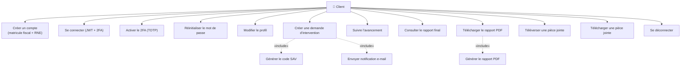
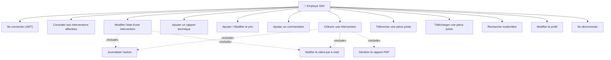

# Étape 2 — Diagrammes des Cas d'Utilisation

## 1. Diagramme Global

Ce diagramme présente la vue d'ensemble de tous les acteurs et leurs interactions avec le système.

```mermaid
graph LR
    subgraph Acteurs
        DIR["🧑‍💼 Directeur"]
        EMP["🔧 Employé SAV"]
        CLI["👤 Client"]
        SYS["⚙️ Système"]
    end

    subgraph "Système de Gestion SAV"
        subgraph "Authentification & Sécurité"
            UC1["Se connecter (JWT)"]
            UC2["Se déconnecter"]
            UC3["Activer le 2FA (TOTP)"]
            UC4["Réinitialiser le mot de passe"]
        end

        subgraph "Gestion des Utilisateurs"
            UC5["Créer un compte client"]
            UC6["CRUD employés"]
            UC7["Consulter les clients"]
            UC8["Activer/Désactiver un compte"]
            UC9["Modifier le profil"]
        end

        subgraph "Gestion des Interventions"
            UC10["Créer une demande"]
            UC11["Consulter toutes les demandes"]
            UC12["Consulter ses interventions"]
            UC13["Affecter une intervention"]
            UC14["Modifier la priorité"]
            UC15["Modifier l'état"]
            UC16["Ajouter un rapport technique"]
            UC17["Ajouter/Modifier le prix"]
            UC18["Ajouter un commentaire"]
            UC19["Clôturer une intervention"]
            UC20["Suivre l'avancement"]
            UC21["Recherche multicritère"]
        end

        subgraph "Documents"
            UC22["Téléverser une pièce jointe"]
            UC23["Télécharger une pièce jointe"]
            UC24["Consulter le rapport final"]
            UC25["Télécharger le rapport PDF"]
        end

        subgraph "Tableau de Bord"
            UC26["Consulter les statistiques"]
            UC27["Consulter le chiffre d affaires"]
        end

        subgraph "Système Automatique"
            UC28["Générer le code intervention"]
            UC29["Envoyer notification e-mail"]
            UC30["Journaliser les actions"]
            UC31["Générer le rapport PDF"]
        end
    end

    DIR --> UC1
    DIR --> UC2
    DIR --> UC6
    DIR --> UC7
    DIR --> UC8
    DIR --> UC9
    DIR --> UC11
    DIR --> UC13
    DIR --> UC14
    DIR --> UC21
    DIR --> UC26
    DIR --> UC27

    EMP --> UC1
    EMP --> UC2
    EMP --> UC9
    EMP --> UC12
    EMP --> UC15
    EMP --> UC16
    EMP --> UC17
    EMP --> UC18
    EMP --> UC19
    EMP --> UC21
    EMP --> UC22
    EMP --> UC23

    CLI --> UC1
    CLI --> UC2
    CLI --> UC3
    CLI --> UC4
    CLI --> UC5
    CLI --> UC9
    CLI --> UC10
    CLI --> UC20
    CLI --> UC22
    CLI --> UC23
    CLI --> UC24
    CLI --> UC25

    SYS --> UC28
    SYS --> UC29
    SYS --> UC30
    SYS --> UC31
```

---

## 2. Diagramme — Acteur : Client

---

## 3. Diagramme — Acteur : Employé SAV

---

## 4. Diagramme — Acteur : Directeur

```mermaid
graph TD
    DIR["🧑‍💼 Directeur"]

    DIR --> UC_D1["Se connecter (JWT)"]
    DIR --> UC_D2["CRUD employés SAV"]
    DIR --> UC_D3["Consulter la liste des clients"]
    DIR --> UC_D4["Activer / Désactiver un compte"]
    DIR --> UC_D5["Consulter toutes les demandes"]
    DIR --> UC_D6["Affecter une intervention à un employé"]
    DIR --> UC_D7["Modifier la priorité d'une intervention"]
    DIR --> UC_D8["Annuler une intervention"]
    DIR --> UC_D9["Recherche multicritère"]
    DIR --> UC_D10["Consulter les statistiques"]
    DIR --> UC_D11["Consulter le chiffre d'affaires"]
    DIR --> UC_D12["Consulter le journal des actions"]
    DIR --> UC_D13["Consulter l'historique des connexions"]
    DIR --> UC_D14["Modifier le profil"]
    DIR --> UC_D15["Se déconnecter"]

    UC_D6 -.->|"«include»"| UC_SYS1["Journaliser l'action"]
    UC_D6 -.->|"«include»"| UC_SYS2["Notifier l'employé par e-mail"]
    UC_D7 -.->|"«include»"| UC_SYS1
    UC_D8 -.->|"«include»"| UC_SYS1
    UC_D8 -.->|"«include»"| UC_SYS3["Notifier le client par e-mail"]
```

---

## 5. Description Textuelle des Cas d'Utilisation Principaux

### UC-01 : Créer un compte client

| Élément | Description |
|---|---|
| **Acteur** | Client |
| **Préconditions** | Aucune |
| **Postconditions** | Le compte est créé, le 2FA doit être activé à la première connexion |
| **Scénario principal** | 1. Le client accède au formulaire d'inscription |
| | 2. Il saisit : nom, prénom, e-mail, mot de passe, téléphone, adresse, matricule fiscal, RNE |
| | 3. Le système valide les données (unicité e-mail, matricule fiscal, RNE ; format mot de passe) |
| | 4. Le système crée le compte avec le rôle CLIENT |
| | 5. Le système envoie un e-mail de confirmation |
| | 6. Le client est redirigé vers la page de connexion |
| **Scénario alternatif** | 3a. E-mail/matricule/RNE déjà existant → message d'erreur |
| | 3b. Mot de passe non conforme → message d'erreur avec règles |

---

### UC-02 : Se connecter avec 2FA

| Élément | Description |
|---|---|
| **Acteur** | Client |
| **Préconditions** | Compte actif existant |
| **Postconditions** | Le client est authentifié et reçoit un token JWT |
| **Scénario principal** | 1. Le client saisit son e-mail et mot de passe |
| | 2. Le système vérifie les identifiants |
| | 3. Si le 2FA n'est pas encore activé → redirection vers l'activation (QR code TOTP) |
| | 4. Si le 2FA est activé → le système demande le code TOTP |
| | 5. Le client saisit le code depuis Google Authenticator |
| | 6. Le système vérifie le code TOTP |
| | 7. Le système génère un token JWT et le retourne |
| | 8. La connexion est journalisée |
| **Scénario alternatif** | 2a. Identifiants incorrects → message d'erreur (max 5 tentatives) |
| | 6a. Code TOTP invalide → message d'erreur |
| | 2b. Compte désactivé → message d'erreur |

---

### UC-03 : Créer une demande d'intervention

| Élément | Description |
|---|---|
| **Acteur** | Client |
| **Préconditions** | Client authentifié |
| **Postconditions** | La demande est créée avec le code SAV généré, état = "Nouvelle" |
| **Scénario principal** | 1. Le client accède au formulaire de création |
| | 2. Il saisit : description du problème, priorité souhaitée |
| | 3. Il peut ajouter des pièces jointes (optionnel) |
| | 4. Le système génère le code unique (SAV-AAAA-NNNNNN) |
| | 5. Le système crée la demande avec état "Nouvelle" et date de création |
| | 6. Le système envoie un e-mail de confirmation au client |
| | 7. L'action est journalisée |
| | 8. Le client est redirigé vers le suivi de sa demande |
| **Scénario alternatif** | 2a. Description vide → message d'erreur |

---

### UC-04 : Affecter une intervention à un employé

| Élément | Description |
|---|---|
| **Acteur** | Directeur |
| **Préconditions** | Intervention à l'état "Nouvelle" |
| **Postconditions** | L'intervention passe à l'état "Affectée", l'employé est notifié |
| **Scénario principal** | 1. Le directeur consulte les demandes à l'état "Nouvelle" |
| | 2. Il sélectionne une intervention |
| | 3. Il choisit un employé dans la liste |
| | 4. Le système affecte l'employé et change l'état à "Affectée" |
| | 5. Le système envoie un e-mail de notification à l'employé |
| | 6. Le système envoie un e-mail au client informant de l'affectation |
| | 7. L'action est journalisée avec l'historique |

---

### UC-05 : Clôturer une intervention

| Élément | Description |
|---|---|
| **Acteur** | Employé SAV |
| **Préconditions** | Intervention à l'état "En cours", rapport technique et prix final renseignés |
| **Postconditions** | L'intervention passe à l'état "Terminée", le rapport PDF est généré |
| **Scénario principal** | 1. L'employé accède à l'intervention |
| | 2. Il vérifie que le rapport technique est complet |
| | 3. Il vérifie que le prix final est renseigné |
| | 4. Il clique sur "Clôturer" |
| | 5. Le système change l'état à "Terminée" et enregistre la date de clôture |
| | 6. Le système génère le rapport PDF |
| | 7. Le système envoie un e-mail au client avec le lien du rapport |
| | 8. L'action est journalisée |
| **Scénario alternatif** | 2a. Rapport technique manquant → message d'erreur |
| | 3a. Prix final non renseigné → message d'erreur |

---

### UC-06 : Consulter les statistiques

| Élément | Description |
|---|---|
| **Acteur** | Directeur |
| **Préconditions** | Directeur authentifié |
| **Postconditions** | Le tableau de bord s'affiche avec les données actualisées |
| **Scénario principal** | 1. Le directeur accède au tableau de bord |
| | 2. Le système affiche : interventions par état, par priorité, CA global et par période, performance employés, évolution mensuelle, temps moyen de résolution |
| | 3. Le directeur peut filtrer par période |

---

## 6. Matrice Acteur × Cas d'Utilisation

| Cas d'utilisation | Directeur | Employé | Client | Système |
|---|:---:|:---:|:---:|:---:|
| Créer un compte | — | — | ✅ | — |
| Se connecter (JWT) | ✅ | ✅ | ✅ | — |
| Activer 2FA (TOTP) | — | — | ✅ | — |
| Réinitialiser mot de passe | ✅ | ✅ | ✅ | — |
| CRUD employés | ✅ | — | — | — |
| Consulter clients | ✅ | — | — | — |
| Activer/Désactiver compte | ✅ | — | — | — |
| Modifier profil | ✅ | ✅ | ✅ | — |
| Créer demande intervention | — | — | ✅ | — |
| Consulter toutes les demandes | ✅ | — | — | — |
| Consulter ses interventions | — | ✅ | — | — |
| Suivre l'avancement | — | — | ✅ | — |
| Affecter intervention | ✅ | — | — | — |
| Modifier priorité | ✅ | — | — | — |
| Modifier état | — | ✅ | — | — |
| Ajouter rapport technique | — | ✅ | — | — |
| Ajouter/modifier prix | — | ✅ | — | — |
| Ajouter commentaire | — | ✅ | — | — |
| Clôturer intervention | — | ✅ | — | — |
| Annuler intervention | ✅ | — | — | — |
| Recherche multicritère | ✅ | ✅ | — | — |
| Téléverser pièce jointe | — | ✅ | ✅ | — |
| Télécharger pièce jointe | ✅ | ✅ | ✅ | — |
| Consulter rapport final | — | — | ✅ | — |
| Télécharger rapport PDF | — | — | ✅ | — |
| Consulter statistiques | ✅ | — | — | — |
| Consulter chiffre d'affaires | ✅ | — | — | — |
| Consulter journal actions | ✅ | — | — | — |
| Consulter historique connexions | ✅ | — | — | — |
| Générer code SAV | — | — | — | ✅ |
| Envoyer notification e-mail | — | — | — | ✅ |
| Journaliser les actions | — | — | — | ✅ |
| Générer rapport PDF | — | — | — | ✅ |
