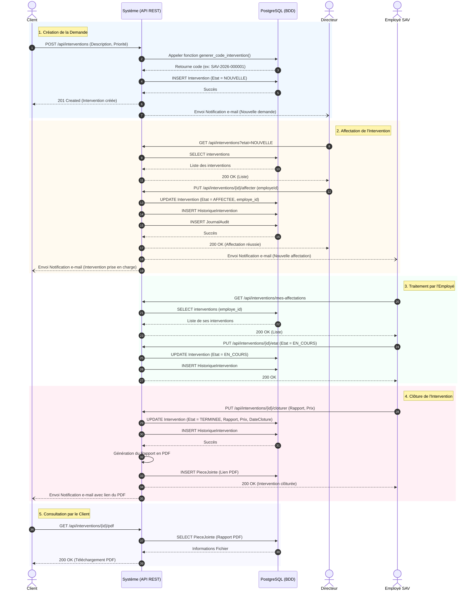

# Diagramme de Séquence (Scénario : Cycle de vie d'une intervention)

Ce diagramme de séquence illustre le scénario principal de l'application : de la création d'une demande par le client jusqu'à sa clôture par l'employé et la notification au client.

## Description du Scénario

1. **Création** : Le client s'authentifie et crée une nouvelle demande. L'API génère automatiquement un code métier (`SAV-YYYY-NNNNNN`), enregistre l'intervention avec l'état `NOUVELLE` et informe le directeur de l'arrivée d'une nouvelle demande.
2. **Affectation** : Le directeur visualise la liste des nouvelles requêtes. Il décide d'en affecter une à un technicien spécifique. L'état passe à `AFFECTEE`. Tout est journalisé pour l'audit et le système notifie l'employé ainsi que le client.
3. **Traitement** : L'employé SAV consulte son planning/ses affectations. Lorsqu'il commence le travail, il modifie le statut à `EN_COURS`.
4. **Clôture** : Une fois la réparation/intervention terminée, l'employé remplit le rapport technique et définit le prix final. L'API valide ces prérequis, passe l'état à `TERMINEE`, déclenche la création d'un document PDF et avertit le client.
5. **Consultation** : Le client reçoit la notification et peut se connecter pour télécharger la version PDF du rapport de son intervention achevée.
