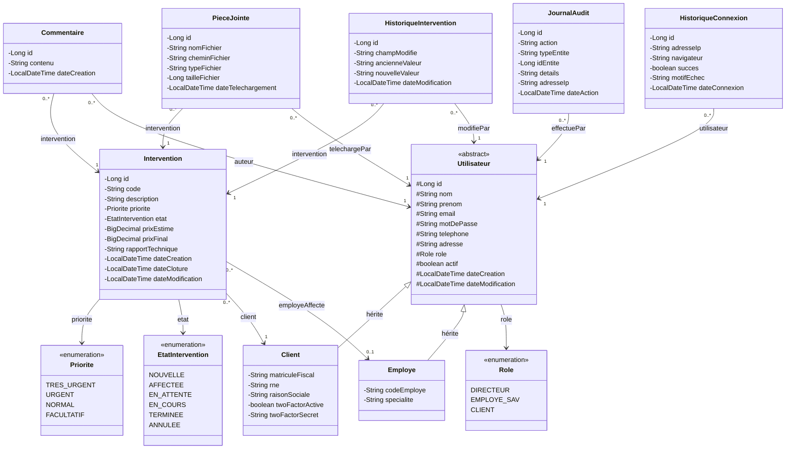

# Étape 3 — Diagramme de Classes UML

## 1. Diagramme de Classes Complet

---

## 2. Description Détaillée des Classes

### 2.1 Classe abstraite `Utilisateur`

Classe de base pour tous les types d'utilisateurs. Stratégie d'héritage JPA : **JOINED** (une table par sous-classe).

| Attribut | Type | Contraintes | Description |
|---|---|---|---|
| `id` | `Long` | PK, auto-généré | Identifiant unique |
| `nom` | `String` | Non null, max 100 | Nom de famille |
| `prenom` | `String` | Non null, max 100 | Prénom |
| `email` | `String` | Non null, unique, format email | Adresse e-mail (login) |
| `motDePasse` | `String` | Non null, min 8, encodé BCrypt | Mot de passe hashé |
| `telephone` | `String` | Max 20 | Numéro de téléphone |
| `adresse` | `String` | Max 500 | Adresse postale |
| `role` | `Role` | Non null, enum | Rôle de l'utilisateur |
| `actif` | `boolean` | Default true | Compte actif ou désactivé |
| `dateCreation` | `LocalDateTime` | Auto, non modifiable | Date de création du compte |
| `dateModification` | `LocalDateTime` | Auto | Dernière modification |

---

### 2.2 Classe `Client` (hérite de `Utilisateur`)

| Attribut | Type | Contraintes | Description |
|---|---|---|---|
| `matriculeFiscal` | `String` | Non null, unique, max 20 | Matricule fiscal de l'entreprise |
| `rne` | `String` | Non null, unique, max 20 | Registre National des Entreprises |
| `raisonSociale` | `String` | Non null, max 200 | Nom de l'entreprise |
| `twoFactorActive` | `boolean` | Default false | 2FA activé ou non |
| `twoFactorSecret` | `String` | Nullable | Clé secrète TOTP (chiffrée) |

---

### 2.3 Classe `Employe` (hérite de `Utilisateur`)

Utilisée pour les rôles `EMPLOYE_SAV` et `DIRECTEUR`.

| Attribut | Type | Contraintes | Description |
|---|---|---|---|
| `codeEmploye` | `String` | Non null, unique, max 20 | Code employé interne (EMP-001) |
| `specialite` | `String` | Nullable, max 100 | Domaine de spécialisation |

---

### 2.4 Classe `Intervention`

Entité centrale du système.

| Attribut | Type | Contraintes | Description |
|---|---|---|---|
| `id` | `Long` | PK, auto-généré | Identifiant technique |
| `code` | `String` | Unique, non null, format SAV-AAAA-NNNNNN | Code métier unique |
| `description` | `String` | Non null, max 2000 | Description du problème |
| `priorite` | `Priorite` | Non null, default NORMAL | Niveau de priorité |
| `etat` | `EtatIntervention` | Non null, default NOUVELLE | État courant |
| `prixEstime` | `BigDecimal` | Nullable, >= 0 | Prix estimé par l'employé |
| `prixFinal` | `BigDecimal` | Nullable, >= 0 | Prix final (requis pour clôture) |
| `rapportTechnique` | `String` | Nullable, max 5000 | Rapport technique détaillé |
| `dateCreation` | `LocalDateTime` | Auto, non modifiable | Date de création |
| `dateCloture` | `LocalDateTime` | Nullable | Date de clôture effective |
| `dateModification` | `LocalDateTime` | Auto | Dernière modification |
| `client` | `Client` | Non null, FK | Client demandeur |
| `employeAffecte` | `Employe` | Nullable, FK | Employé assigné |

**Relations :**
- `ManyToOne` → `Client` (obligatoire)
- `ManyToOne` → `Employe` (nullable tant que l'état est "Nouvelle")
- `OneToMany` → `Commentaire`
- `OneToMany` → `PieceJointe`
- `OneToMany` → `HistoriqueIntervention`

---

### 2.5 Classe `Commentaire`

| Attribut | Type | Contraintes | Description |
|---|---|---|---|
| `id` | `Long` | PK, auto-généré | Identifiant unique |
| `contenu` | `String` | Non null, max 2000 | Texte du commentaire |
| `dateCreation` | `LocalDateTime` | Auto, non modifiable | Date de création |
| `intervention` | `Intervention` | Non null, FK | Intervention concernée |
| `auteur` | `Utilisateur` | Non null, FK | Auteur du commentaire |

---

### 2.6 Classe `PieceJointe`

| Attribut | Type | Contraintes | Description |
|---|---|---|---|
| `id` | `Long` | PK, auto-généré | Identifiant unique |
| `nomFichier` | `String` | Non null, max 255 | Nom original du fichier |
| `cheminFichier` | `String` | Non null, max 500 | Chemin de stockage sur le serveur |
| `typeFichier` | `String` | Non null, max 100 | Type MIME (application/pdf, image/png…) |
| `tailleFichier` | `Long` | Non null, > 0 | Taille en octets |
| `dateTelechargement` | `LocalDateTime` | Auto | Date d'upload |
| `intervention` | `Intervention` | Non null, FK | Intervention associée |
| `telechargePar` | `Utilisateur` | Non null, FK | Utilisateur ayant uploadé |

---

### 2.7 Classe `HistoriqueIntervention`

Trace chaque modification d'une intervention pour l'audit métier.

| Attribut | Type | Contraintes | Description |
|---|---|---|---|
| `id` | `Long` | PK, auto-généré | Identifiant unique |
| `champModifie` | `String` | Non null, max 100 | Nom du champ modifié (etat, priorite…) |
| `ancienneValeur` | `String` | Nullable, max 500 | Valeur avant modification |
| `nouvelleValeur` | `String` | Non null, max 500 | Valeur après modification |
| `dateModification` | `LocalDateTime` | Auto | Date du changement |
| `intervention` | `Intervention` | Non null, FK | Intervention concernée |
| `modifiePar` | `Utilisateur` | Non null, FK | Utilisateur ayant effectué le changement |

---

### 2.8 Classe `JournalAudit`

Journal technique de toutes les actions du système (audit global).

| Attribut | Type | Contraintes | Description |
|---|---|---|---|
| `id` | `Long` | PK, auto-généré | Identifiant unique |
| `action` | `String` | Non null, max 50 | Type d'action (CREATION, MODIFICATION, SUPPRESSION, CONNEXION…) |
| `typeEntite` | `String` | Non null, max 100 | Entité concernée (Intervention, Utilisateur…) |
| `idEntite` | `Long` | Nullable | ID de l'entité concernée |
| `details` | `String` | Nullable, max 2000 | Détails de l'action (JSON) |
| `adresseIp` | `String` | Nullable, max 45 | Adresse IP du client |
| `dateAction` | `LocalDateTime` | Auto | Date et heure de l'action |
| `effectuePar` | `Utilisateur` | Non null, FK | Utilisateur ayant effectué l'action |

---

### 2.9 Classe `HistoriqueConnexion`

Historique de toutes les tentatives de connexion.

| Attribut | Type | Contraintes | Description |
|---|---|---|---|
| `id` | `Long` | PK, auto-généré | Identifiant unique |
| `adresseIp` | `String` | Nullable, max 45 | Adresse IP |
| `navigateur` | `String` | Nullable, max 255 | User-Agent du navigateur |
| `succes` | `boolean` | Non null | Connexion réussie ou échouée |
| `motifEchec` | `String` | Nullable, max 200 | Raison de l'échec le cas échéant |
| `dateConnexion` | `LocalDateTime` | Auto | Date et heure de la tentative |
| `utilisateur` | `Utilisateur` | Non null, FK | Utilisateur concerné |

---

## 3. Énumérations

### `Role`
| Valeur | Description |
|---|---|
| `DIRECTEUR` | Administrateur principal du système |
| `EMPLOYE_SAV` | Technicien SAV |
| `CLIENT` | Client externe |

### `Priorite`
| Valeur | Description | Ordre |
|---|---|---|
| `TRES_URGENT` | Intervention critique | 1 (plus haute) |
| `URGENT` | Intervention prioritaire | 2 |
| `NORMAL` | Priorité standard | 3 |
| `FACULTATIF` | Peut attendre | 4 (plus basse) |

### `EtatIntervention`
| Valeur | Description |
|---|---|
| `NOUVELLE` | Demande créée par le client, non encore traitée |
| `AFFECTEE` | Un employé a été assigné par le directeur |
| `EN_ATTENTE` | Intervention mise en pause (attente de pièce, info…) |
| `EN_COURS` | Travail en cours par l'employé |
| `TERMINEE` | Intervention clôturée avec rapport |
| `ANNULEE` | Intervention annulée par le directeur |

---

## 4. Résumé des Relations

| Relation | Type | Cardinalité | Description |
|---|---|---|---|
| `Intervention` → `Client` | ManyToOne | N..1 | Chaque intervention appartient à un client |
| `Intervention` → `Employe` | ManyToOne | N..0..1 | Une intervention peut être affectée à un employé |
| `Intervention` → `Commentaire` | OneToMany | 1..N | Une intervention a 0 à N commentaires |
| `Intervention` → `PieceJointe` | OneToMany | 1..N | Une intervention a 0 à N pièces jointes |
| `Intervention` → `HistoriqueIntervention` | OneToMany | 1..N | Une intervention a 0 à N entrées d'historique |
| `Commentaire` → `Utilisateur` | ManyToOne | N..1 | Chaque commentaire a un auteur |
| `PieceJointe` → `Utilisateur` | ManyToOne | N..1 | Chaque pièce jointe a un uploadeur |
| `HistoriqueIntervention` → `Utilisateur` | ManyToOne | N..1 | Chaque modification est tracée à un utilisateur |
| `JournalAudit` → `Utilisateur` | ManyToOne | N..1 | Chaque action est tracée à un utilisateur |
| `HistoriqueConnexion` → `Utilisateur` | ManyToOne | N..1 | Chaque connexion est liée à un utilisateur |
| `Utilisateur` ← `Client` | Héritage JOINED | — | Client hérite d'Utilisateur |
| `Utilisateur` ← `Employe` | Héritage JOINED | — | Employé hérite d'Utilisateur |

---

## 5. Décisions de Conception

> [!NOTE]
> **Héritage JOINED** : J'ai choisi la stratégie `JOINED` pour l'héritage `Utilisateur` → `Client`/`Employe`. Cela crée 3 tables (`utilisateur`, `client`, `employe`) avec des clés étrangères. C'est le meilleur compromis entre normalisation et performance pour ce cas d'usage.

> [!NOTE]
> **Séparation HistoriqueIntervention / JournalAudit** : L'`HistoriqueIntervention` trace les changements métier d'une intervention spécifique (champ par champ), tandis que le `JournalAudit` est un journal technique global de toutes les actions du système. Les deux sont complémentaires.

> [!NOTE]
> **BigDecimal pour les prix** : Utilisation de `BigDecimal` au lieu de `Double` pour les montants financiers afin d'éviter les erreurs d'arrondi en virgule flottante.

> [!NOTE]
> **Le Directeur est un Employé** : Le directeur est modélisé comme un `Employe` avec le rôle `DIRECTEUR`. Cela simplifie le modèle tout en conservant la distinction via l'enum `Role`.
