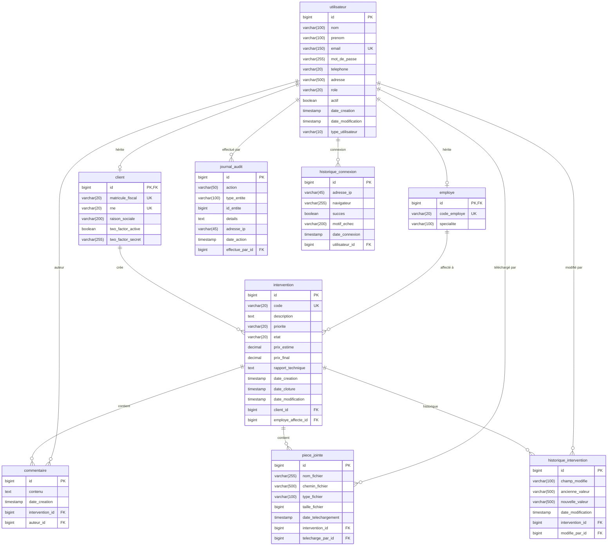

# Étape 4 — Modèle Relationnel et Base de Données PostgreSQL

## 1. Schéma Relationnel



---

## 2. Script SQL de Création

### 2.1 Création de la base de données et du schéma

```sql
-- ============================================================
-- Application SAV - Script de création de la base de données
-- PostgreSQL 16+
-- ============================================================

-- Créer la base de données (à exécuter en tant que superadmin)
CREATE DATABASE sav_gestion
    WITH ENCODING = 'UTF8'
    LC_COLLATE = 'fr_FR.UTF-8'
    LC_CTYPE = 'fr_FR.UTF-8'
    TEMPLATE = template0;

-- Se connecter à la base sav_gestion, puis exécuter la suite

-- Créer un utilisateur applicatif
CREATE USER sav_app WITH PASSWORD 'sav_secure_password_2026';

-- Accorder les droits
GRANT CONNECT ON DATABASE sav_gestion TO sav_app;
GRANT USAGE ON SCHEMA public TO sav_app;
```

### 2.2 Séquences

```sql
-- ============================================================
-- SÉQUENCES
-- ============================================================

-- Séquence pour le compteur annuel des codes intervention
CREATE SEQUENCE seq_intervention_code
    START WITH 1
    INCREMENT BY 1
    NO MAXVALUE
    CACHE 1;
```

### 2.3 Table `utilisateur`

```sql
-- ============================================================
-- TABLE : utilisateur (table mère - héritage JOINED)
-- ============================================================
CREATE TABLE utilisateur (
    id                  BIGSERIAL       PRIMARY KEY,
    nom                 VARCHAR(100)    NOT NULL,
    prenom              VARCHAR(100)    NOT NULL,
    email               VARCHAR(150)    NOT NULL,
    mot_de_passe        VARCHAR(255)    NOT NULL,
    telephone           VARCHAR(20),
    adresse             VARCHAR(500),
    role                VARCHAR(20)     NOT NULL,
    actif               BOOLEAN         NOT NULL DEFAULT TRUE,
    date_creation       TIMESTAMP       NOT NULL DEFAULT CURRENT_TIMESTAMP,
    date_modification   TIMESTAMP       NOT NULL DEFAULT CURRENT_TIMESTAMP,
    type_utilisateur    VARCHAR(10)     NOT NULL,

    CONSTRAINT uk_utilisateur_email UNIQUE (email),
    CONSTRAINT ck_utilisateur_role CHECK (role IN ('DIRECTEUR', 'EMPLOYE_SAV', 'CLIENT')),
    CONSTRAINT ck_utilisateur_type CHECK (type_utilisateur IN ('CLIENT', 'EMPLOYE'))
);

CREATE INDEX idx_utilisateur_email ON utilisateur (email);
CREATE INDEX idx_utilisateur_role ON utilisateur (role);
CREATE INDEX idx_utilisateur_actif ON utilisateur (actif);
```

### 2.4 Table `client`

```sql
-- ============================================================
-- TABLE : client (hérite de utilisateur)
-- ============================================================
CREATE TABLE client (
    id                  BIGINT          PRIMARY KEY,
    matricule_fiscal    VARCHAR(20)     NOT NULL,
    rne                 VARCHAR(20)     NOT NULL,
    raison_sociale      VARCHAR(200)    NOT NULL,
    two_factor_active   BOOLEAN         NOT NULL DEFAULT FALSE,
    two_factor_secret   VARCHAR(255),

    CONSTRAINT fk_client_utilisateur FOREIGN KEY (id)
        REFERENCES utilisateur (id) ON DELETE CASCADE,
    CONSTRAINT uk_client_matricule_fiscal UNIQUE (matricule_fiscal),
    CONSTRAINT uk_client_rne UNIQUE (rne)
);

CREATE INDEX idx_client_matricule ON client (matricule_fiscal);
CREATE INDEX idx_client_rne ON client (rne);
```

### 2.5 Table `employe`

```sql
-- ============================================================
-- TABLE : employe (hérite de utilisateur)
-- ============================================================
CREATE TABLE employe (
    id                  BIGINT          PRIMARY KEY,
    code_employe        VARCHAR(20)     NOT NULL,
    specialite          VARCHAR(100),

    CONSTRAINT fk_employe_utilisateur FOREIGN KEY (id)
        REFERENCES utilisateur (id) ON DELETE CASCADE,
    CONSTRAINT uk_employe_code UNIQUE (code_employe)
);

CREATE INDEX idx_employe_code ON employe (code_employe);
```

### 2.6 Table `intervention`

```sql
-- ============================================================
-- TABLE : intervention
-- ============================================================
CREATE TABLE intervention (
    id                  BIGSERIAL       PRIMARY KEY,
    code                VARCHAR(20)     NOT NULL,
    description         TEXT            NOT NULL,
    priorite            VARCHAR(20)     NOT NULL DEFAULT 'NORMAL',
    etat                VARCHAR(20)     NOT NULL DEFAULT 'NOUVELLE',
    prix_estime         DECIMAL(12, 3),
    prix_final          DECIMAL(12, 3),
    rapport_technique   TEXT,
    date_creation       TIMESTAMP       NOT NULL DEFAULT CURRENT_TIMESTAMP,
    date_cloture        TIMESTAMP,
    date_modification   TIMESTAMP       NOT NULL DEFAULT CURRENT_TIMESTAMP,
    client_id           BIGINT          NOT NULL,
    employe_affecte_id  BIGINT,

    CONSTRAINT uk_intervention_code UNIQUE (code),
    CONSTRAINT fk_intervention_client FOREIGN KEY (client_id)
        REFERENCES client (id) ON DELETE RESTRICT,
    CONSTRAINT fk_intervention_employe FOREIGN KEY (employe_affecte_id)
        REFERENCES employe (id) ON DELETE SET NULL,
    CONSTRAINT ck_intervention_priorite CHECK (
        priorite IN ('TRES_URGENT', 'URGENT', 'NORMAL', 'FACULTATIF')
    ),
    CONSTRAINT ck_intervention_etat CHECK (
        etat IN ('NOUVELLE', 'AFFECTEE', 'EN_ATTENTE', 'EN_COURS', 'TERMINEE', 'ANNULEE')
    ),
    CONSTRAINT ck_intervention_prix_estime CHECK (prix_estime IS NULL OR prix_estime >= 0),
    CONSTRAINT ck_intervention_prix_final CHECK (prix_final IS NULL OR prix_final >= 0)
);

CREATE INDEX idx_intervention_code ON intervention (code);
CREATE INDEX idx_intervention_etat ON intervention (etat);
CREATE INDEX idx_intervention_priorite ON intervention (priorite);
CREATE INDEX idx_intervention_client ON intervention (client_id);
CREATE INDEX idx_intervention_employe ON intervention (employe_affecte_id);
CREATE INDEX idx_intervention_date_creation ON intervention (date_creation DESC);
```

### 2.7 Table `commentaire`

```sql
-- ============================================================
-- TABLE : commentaire
-- ============================================================
CREATE TABLE commentaire (
    id                  BIGSERIAL       PRIMARY KEY,
    contenu             TEXT            NOT NULL,
    date_creation       TIMESTAMP       NOT NULL DEFAULT CURRENT_TIMESTAMP,
    intervention_id     BIGINT          NOT NULL,
    auteur_id           BIGINT          NOT NULL,

    CONSTRAINT fk_commentaire_intervention FOREIGN KEY (intervention_id)
        REFERENCES intervention (id) ON DELETE CASCADE,
    CONSTRAINT fk_commentaire_auteur FOREIGN KEY (auteur_id)
        REFERENCES utilisateur (id) ON DELETE RESTRICT
);

CREATE INDEX idx_commentaire_intervention ON commentaire (intervention_id);
CREATE INDEX idx_commentaire_auteur ON commentaire (auteur_id);
CREATE INDEX idx_commentaire_date ON commentaire (date_creation DESC);
```

### 2.8 Table `piece_jointe`

```sql
-- ============================================================
-- TABLE : piece_jointe
-- ============================================================
CREATE TABLE piece_jointe (
    id                      BIGSERIAL       PRIMARY KEY,
    nom_fichier             VARCHAR(255)    NOT NULL,
    chemin_fichier          VARCHAR(500)    NOT NULL,
    type_fichier            VARCHAR(100)    NOT NULL,
    taille_fichier          BIGINT          NOT NULL,
    date_telechargement     TIMESTAMP       NOT NULL DEFAULT CURRENT_TIMESTAMP,
    intervention_id         BIGINT          NOT NULL,
    telecharge_par_id       BIGINT          NOT NULL,

    CONSTRAINT fk_piece_jointe_intervention FOREIGN KEY (intervention_id)
        REFERENCES intervention (id) ON DELETE CASCADE,
    CONSTRAINT fk_piece_jointe_utilisateur FOREIGN KEY (telecharge_par_id)
        REFERENCES utilisateur (id) ON DELETE RESTRICT,
    CONSTRAINT ck_piece_jointe_taille CHECK (taille_fichier > 0)
);

CREATE INDEX idx_piece_jointe_intervention ON piece_jointe (intervention_id);
```

### 2.9 Table `historique_intervention`

```sql
-- ============================================================
-- TABLE : historique_intervention
-- ============================================================
CREATE TABLE historique_intervention (
    id                  BIGSERIAL       PRIMARY KEY,
    champ_modifie       VARCHAR(100)    NOT NULL,
    ancienne_valeur     VARCHAR(500),
    nouvelle_valeur     VARCHAR(500)    NOT NULL,
    date_modification   TIMESTAMP       NOT NULL DEFAULT CURRENT_TIMESTAMP,
    intervention_id     BIGINT          NOT NULL,
    modifie_par_id      BIGINT          NOT NULL,

    CONSTRAINT fk_historique_intervention FOREIGN KEY (intervention_id)
        REFERENCES intervention (id) ON DELETE CASCADE,
    CONSTRAINT fk_historique_modifie_par FOREIGN KEY (modifie_par_id)
        REFERENCES utilisateur (id) ON DELETE RESTRICT
);

CREATE INDEX idx_historique_intervention ON historique_intervention (intervention_id);
CREATE INDEX idx_historique_date ON historique_intervention (date_modification DESC);
```

### 2.10 Table `journal_audit`

```sql
-- ============================================================
-- TABLE : journal_audit
-- ============================================================
CREATE TABLE journal_audit (
    id                  BIGSERIAL       PRIMARY KEY,
    action              VARCHAR(50)     NOT NULL,
    type_entite         VARCHAR(100)    NOT NULL,
    id_entite           BIGINT,
    details             TEXT,
    adresse_ip          VARCHAR(45),
    date_action         TIMESTAMP       NOT NULL DEFAULT CURRENT_TIMESTAMP,
    effectue_par_id     BIGINT          NOT NULL,

    CONSTRAINT fk_audit_utilisateur FOREIGN KEY (effectue_par_id)
        REFERENCES utilisateur (id) ON DELETE RESTRICT
);

CREATE INDEX idx_audit_action ON journal_audit (action);
CREATE INDEX idx_audit_type_entite ON journal_audit (type_entite);
CREATE INDEX idx_audit_date ON journal_audit (date_action DESC);
CREATE INDEX idx_audit_utilisateur ON journal_audit (effectue_par_id);
```

### 2.11 Table `historique_connexion`

```sql
-- ============================================================
-- TABLE : historique_connexion
-- ============================================================
CREATE TABLE historique_connexion (
    id                  BIGSERIAL       PRIMARY KEY,
    adresse_ip          VARCHAR(45),
    navigateur          VARCHAR(255),
    succes              BOOLEAN         NOT NULL,
    motif_echec         VARCHAR(200),
    date_connexion      TIMESTAMP       NOT NULL DEFAULT CURRENT_TIMESTAMP,
    utilisateur_id      BIGINT          NOT NULL,

    CONSTRAINT fk_connexion_utilisateur FOREIGN KEY (utilisateur_id)
        REFERENCES utilisateur (id) ON DELETE CASCADE
);

CREATE INDEX idx_connexion_utilisateur ON historique_connexion (utilisateur_id);
CREATE INDEX idx_connexion_date ON historique_connexion (date_connexion DESC);
CREATE INDEX idx_connexion_succes ON historique_connexion (succes);
```

### 2.12 Accorder les droits à l'utilisateur applicatif

```sql
-- ============================================================
-- DROITS
-- ============================================================
GRANT SELECT, INSERT, UPDATE, DELETE ON ALL TABLES IN SCHEMA public TO sav_app;
GRANT USAGE, SELECT ON ALL SEQUENCES IN SCHEMA public TO sav_app;
```

---

## 3. Données Initiales

```sql
-- ============================================================
-- DONNÉES INITIALES
-- ============================================================

-- Créer le compte Directeur par défaut
-- Mot de passe : Admin@2026 (hashé avec BCrypt)
INSERT INTO utilisateur (nom, prenom, email, mot_de_passe, telephone, role, actif, type_utilisateur)
VALUES (
    'Admin',
    'Directeur',
    'directeur@sav-gestion.com',
    '$2a$10$xxxxxxxxxxxxxxxxxxxxxxxxxxxxxxxxxxxxxxxxxxxxxxxxxxx',
    '+216 00 000 000',
    'DIRECTEUR',
    TRUE,
    'EMPLOYE'
);

INSERT INTO employe (id, code_employe, specialite)
VALUES (
    (SELECT id FROM utilisateur WHERE email = 'directeur@sav-gestion.com'),
    'DIR-001',
    'Direction Générale'
);
```

---

## 4. Fonction de Génération du Code Intervention

```sql
-- ============================================================
-- FONCTION : Génération du code intervention SAV-AAAA-NNNNNN
-- ============================================================
CREATE OR REPLACE FUNCTION generer_code_intervention()
RETURNS VARCHAR(20) AS $$
DECLARE
    annee_courante  INTEGER;
    prochain_numero BIGINT;
    code_genere     VARCHAR(20);
BEGIN
    annee_courante := EXTRACT(YEAR FROM CURRENT_TIMESTAMP);

    -- Compter le nombre d'interventions de l'année en cours + 1
    SELECT COALESCE(MAX(
        CAST(SUBSTRING(code FROM 10 FOR 6) AS INTEGER)
    ), 0) + 1
    INTO prochain_numero
    FROM intervention
    WHERE SUBSTRING(code FROM 5 FOR 4) = annee_courante::TEXT;

    -- Formater le code : SAV-2026-000001
    code_genere := 'SAV-' || annee_courante::TEXT || '-' || LPAD(prochain_numero::TEXT, 6, '0');

    RETURN code_genere;
END;
$$ LANGUAGE plpgsql;
```

---

## 5. Résumé des Tables

| Table | Colonnes | Clé primaire | Clés étrangères | Index |
|---|:---:|---|---|:---:|
| `utilisateur` | 11 | `id` (BIGSERIAL) | — | 3 |
| `client` | 5 | `id` (FK) | → `utilisateur` | 2 |
| `employe` | 3 | `id` (FK) | → `utilisateur` | 1 |
| `intervention` | 13 | `id` (BIGSERIAL) | → `client`, → `employe` | 6 |
| `commentaire` | 5 | `id` (BIGSERIAL) | → `intervention`, → `utilisateur` | 3 |
| `piece_jointe` | 8 | `id` (BIGSERIAL) | → `intervention`, → `utilisateur` | 1 |
| `historique_intervention` | 7 | `id` (BIGSERIAL) | → `intervention`, → `utilisateur` | 2 |
| `journal_audit` | 8 | `id` (BIGSERIAL) | → `utilisateur` | 4 |
| `historique_connexion` | 7 | `id` (BIGSERIAL) | → `utilisateur` | 3 |
| **Total** | **67** | **9** | **12** | **25** |

---

## 6. Décisions Techniques

> [!NOTE]
> **DECIMAL(12, 3) pour les prix** : Précision à 3 décimales pour le Dinar Tunisien (TND) qui utilise 3 décimales (millimes). 12 chiffres au total permettent des montants jusqu'à 999 999 999,999 TND.

> [!NOTE]
> **VARCHAR pour les enums au lieu de types PostgreSQL ENUM** : Les enums sont stockés en `VARCHAR` avec des contraintes `CHECK`. Cela simplifie l'évolution (ajout de nouvelles valeurs) sans migration ALTER TYPE, et reste compatible avec JPA/Hibernate qui mappe les enums Java en String.

> [!NOTE]
> **ON DELETE RESTRICT sur client → intervention** : Empêche la suppression d'un client ayant des interventions. Il faudra d'abord clôturer ou annuler toutes ses interventions.

> [!NOTE]
> **ON DELETE SET NULL sur employe → intervention** : Si un employé est supprimé, l'intervention reste mais perd l'affectation. Le directeur pourra réaffecter.

> [!NOTE]
> **ON DELETE CASCADE sur utilisateur → client/employe** : La suppression d'un utilisateur supprime automatiquement ses données spécifiques (client ou employé).

> [!NOTE]
> **Index stratégiques** : Les index sont placés sur les colonnes fréquemment utilisées dans les filtres (état, priorité, dates) et les jointures (clés étrangères). Les index sur les dates sont en ordre `DESC` pour optimiser les requêtes les plus récentes.
