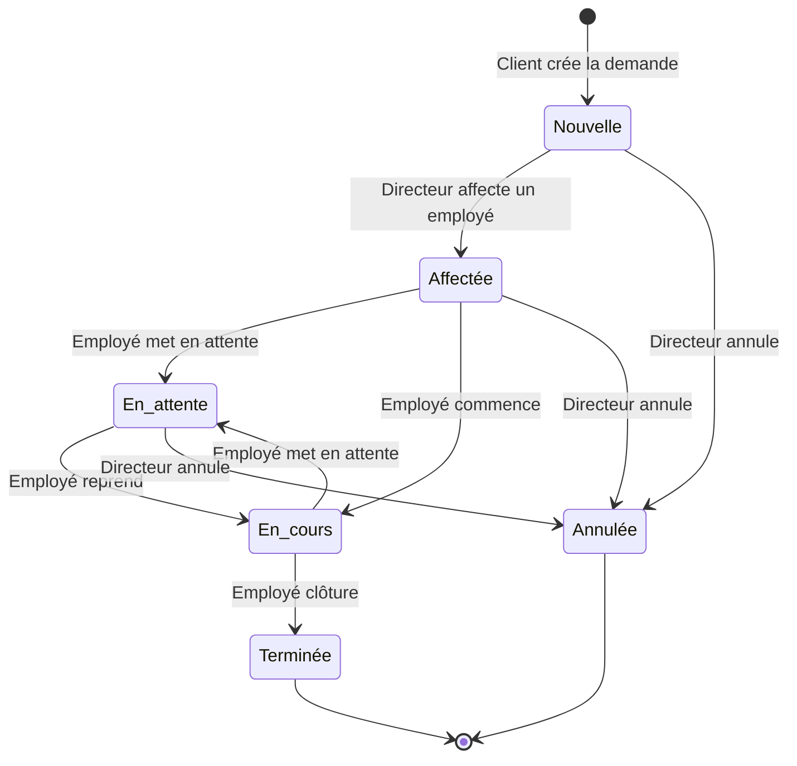

# Application de Gestion des Interventions SAV — Analyse des Besoins

## 1. Contexte et Objectif

L'objectif est de développer une application web professionnelle permettant de gérer le cycle de vie complet des interventions SAV (Service Après-Vente), depuis la création d'une demande par un client jusqu'à la clôture et la génération du rapport final.

L'application doit offrir :
- Un portail client pour soumettre et suivre les demandes
- Un espace employé pour gérer les interventions affectées
- Un tableau de bord directeur pour le pilotage global et les statistiques

---

## 2. Identification des Acteurs

| Acteur | Rôle | Authentification |
|---|---|---|
| **Directeur** | Administrateur principal. Gère les employés, clients, affectations et consulte les statistiques globales. | JWT |
| **Employé SAV** | Technicien. Gère les interventions qui lui sont affectées (état, rapport, prix, commentaires). | JWT |
| **Client** | Demandeur. Crée un compte, soumet des demandes d'intervention, suit l'avancement. | JWT + 2FA (TOTP) |
| **Système** | Acteur technique. Génère les codes, envoie les notifications, journalise les actions. | — |

---

## 3. Besoins Fonctionnels

### 3.1 Module Authentification & Sécurité

| ID | Fonctionnalité | Acteur(s) | Priorité |
|---|---|---|---|
| AUTH-01 | Inscription client (avec matricule fiscal + RNE) | Client | Haute |
| AUTH-02 | Connexion avec JWT | Tous | Haute |
| AUTH-03 | Double authentification TOTP (Google Authenticator) | Client | Haute |
| AUTH-04 | Déconnexion et invalidation du token | Tous | Haute |
| AUTH-05 | Gestion des rôles (DIRECTEUR, EMPLOYE, CLIENT) | Système | Haute |
| AUTH-06 | Historique des connexions | Directeur | Moyenne |
| AUTH-07 | Réinitialisation du mot de passe | Tous | Moyenne |

### 3.2 Module Gestion des Utilisateurs

| ID | Fonctionnalité | Acteur(s) | Priorité |
|---|---|---|---|
| USR-01 | CRUD employés SAV | Directeur | Haute |
| USR-02 | Consulter la liste des clients | Directeur | Haute |
| USR-03 | Activer / Désactiver un compte | Directeur | Haute |
| USR-04 | Modifier le profil personnel | Tous | Moyenne |

### 3.3 Module Interventions SAV

| ID | Fonctionnalité | Acteur(s) | Priorité |
|---|---|---|---|
| INT-01 | Créer une demande d'intervention | Client | Haute |
| INT-02 | Génération automatique du code (SAV-AAAA-000001) | Système | Haute |
| INT-03 | Consulter toutes les demandes | Directeur | Haute |
| INT-04 | Consulter ses interventions affectées | Employé | Haute |
| INT-05 | Affecter une intervention à un employé | Directeur | Haute |
| INT-06 | Modifier la priorité d'une intervention | Directeur | Haute |
| INT-07 | Modifier l'état d'une intervention | Employé | Haute |
| INT-08 | Ajouter un rapport technique | Employé | Haute |
| INT-09 | Ajouter/modifier le prix (estimé + final) | Employé | Haute |
| INT-10 | Ajouter des commentaires | Employé | Haute |
| INT-11 | Clôturer une intervention | Employé | Haute |
| INT-12 | Suivre l'avancement d'une demande | Client | Haute |
| INT-13 | Consulter le rapport final | Client | Haute |
| INT-14 | Recherche multicritère | Directeur, Employé | Moyenne |
| INT-15 | Historique des modifications d'une intervention | Tous (selon rôle) | Moyenne |

### 3.4 Module Documents & Pièces Jointes

| ID | Fonctionnalité | Acteur(s) | Priorité |
|---|---|---|---|
| DOC-01 | Téléverser des pièces jointes à une intervention | Client, Employé | Moyenne |
| DOC-02 | Télécharger les pièces jointes | Tous (selon rôle) | Moyenne |
| DOC-03 | Générer le rapport PDF d'une intervention | Système | Haute |
| DOC-04 | Télécharger le rapport PDF | Client | Haute |

### 3.5 Module Notifications

| ID | Fonctionnalité | Acteur(s) | Priorité |
|---|---|---|---|
| NOT-01 | Notification e-mail à la création d'une demande | Client | Moyenne |
| NOT-02 | Notification e-mail à l'affectation | Employé | Moyenne |
| NOT-03 | Notification e-mail au changement d'état | Client | Moyenne |
| NOT-04 | Notification e-mail à la clôture | Client | Moyenne |

### 3.6 Module Tableau de Bord & Statistiques

| ID | Fonctionnalité | Acteur(s) | Priorité |
|---|---|---|---|
| DASH-01 | Nombre d'interventions par état | Directeur | Haute |
| DASH-02 | Nombre d'interventions par priorité | Directeur | Haute |
| DASH-03 | Chiffre d'affaires (global, par période) | Directeur | Haute |
| DASH-04 | Performance par employé | Directeur | Moyenne |
| DASH-05 | Évolution mensuelle des demandes | Directeur | Moyenne |
| DASH-06 | Temps moyen de résolution | Directeur | Moyenne |

### 3.7 Module Audit

| ID | Fonctionnalité | Acteur(s) | Priorité |
|---|---|---|---|
| AUD-01 | Journaliser toutes les actions (création, modification, suppression) | Système | Haute |
| AUD-02 | Consulter le journal des actions | Directeur | Haute |
| AUD-03 | Journaliser les connexions/déconnexions | Système | Moyenne |

---

## 4. Besoins Non-Fonctionnels

| Catégorie | Exigence |
|---|---|
| **Performance** | Temps de réponse API < 500ms pour 95% des requêtes |
| **Sécurité** | Mots de passe hashés (BCrypt), tokens JWT signés, protection CSRF, validation des entrées |
| **Scalabilité** | Architecture en couches découplée permettant l'évolution |
| **Maintenabilité** | Principes SOLID, code propre, séparation DTO/Entity |
| **Disponibilité** | Application stateless (JWT), prête pour le déploiement containerisé |
| **Compatibilité** | Navigateurs modernes (Chrome, Firefox, Edge, Safari) |
| **Internationalisation** | Messages d'erreur en français (extensible) |

---

## 5. Règles Métier

### 5.1 Cycle de vie d'une intervention



### 5.2 Règles de transition d'état

| Transition | Conditions | Qui peut la faire |
|---|---|---|
| Nouvelle → Affectée | Un employé doit être sélectionné | Directeur |
| Affectée → En cours | — | Employé affecté |
| Affectée → En attente | Un motif doit être fourni | Employé affecté |
| En attente → En cours | — | Employé affecté |
| En cours → Terminée | Le rapport technique et le prix final doivent être renseignés | Employé affecté |
| En cours → En attente | Un motif doit être fourni | Employé affecté |
| Nouvelle/Affectée/En attente → Annulée | Un motif doit être fourni | Directeur |

### 5.3 Règles de gestion du code

- Format : `SAV-AAAA-NNNNNN` où `AAAA` = année en cours, `NNNNNN` = compteur séquentiel à 6 chiffres
- Exemple : `SAV-2026-000001`, `SAV-2026-000002`
- Le compteur se réinitialise chaque année

### 5.4 Règles d'inscription client

- Le matricule fiscal est obligatoire et unique
- Le RNE (Registre National des Entreprises) est obligatoire et unique
- L'e-mail doit être unique et valide
- Le mot de passe doit contenir au minimum 8 caractères, une majuscule, une minuscule, un chiffre et un caractère spécial
- L'activation du 2FA est obligatoire dès la première connexion

---

## 6. Architecture Technique

### 6.1 Stack technologique

| Couche | Technologie |
|---|---|
| **Frontend** | React 18+ (Vite), Axios, React Router, Chart.js/Recharts |
| **Backend** | Java 21, Spring Boot 3.x |
| **Sécurité** | Spring Security 6, JWT (jjwt), TOTP (Google Authenticator) |
| **ORM** | Spring Data JPA (Hibernate) |
| **Base de données** | PostgreSQL 16 |
| **Documentation API** | SpringDoc OpenAPI (Swagger UI) |
| **PDF** | iText ou Apache PDFBox |
| **E-mail** | Spring Mail (JavaMailSender) |
| **Build** | Maven |
| **Versioning** | Git |

### 6.2 Architecture en couches (Backend)

```
┌─────────────────────────────────────────┐
│              Controller Layer            │  ← API REST (DTOs in/out)
├─────────────────────────────────────────┤
│               Service Layer              │  ← Logique métier
├─────────────────────────────────────────┤
│             Repository Layer             │  ← Accès données (JPA)
├─────────────────────────────────────────┤
│               Entity Layer               │  ← Modèle de données
├─────────────────────────────────────────┤
│              PostgreSQL DB               │  ← Persistance
└─────────────────────────────────────────┘

Modules transverses :
├── Security (JWT + 2FA)
├── Exception (GlobalExceptionHandler)
├── DTO + Mapper
├── Config (CORS, Mail, Swagger)
├── Audit (Event Logging)
└── Notification (Email Service)
```

### 6.3 Structure des packages (Backend)

```
com.sav.gestion
├── config/           # Configuration Spring (CORS, Swagger, Mail, Security)
├── security/         # JWT, filtres, 2FA, UserDetailsService
├── controller/       # Contrôleurs REST
├── service/          # Interfaces et implémentations des services
├── repository/       # Interfaces JPA
├── entity/           # Entités JPA
├── dto/              # Objets de transfert (request/response)
├── mapper/           # Convertisseurs Entity ↔ DTO
├── exception/        # Exceptions personnalisées + GlobalHandler
├── audit/            # Journalisation des actions
├── notification/     # Service d'envoi d'e-mails
└── util/             # Utilitaires (génération de code, etc.)
```

---

## 7. Planning de Développement

| Étape | Description | Statut |
|---|---|---|
| 1 | Analyse des besoins | 🔄 En cours |
| 2 | Diagramme des cas d'utilisation | ⏳ À venir |
| 3 | Diagramme de classes UML | ⏳ À venir |
| 4 | Modèle relationnel & scripts SQL | ⏳ À venir |
| 5 | Création du projet Spring Boot | ⏳ À venir |
| 6 | Configuration PostgreSQL | ⏳ À venir |
| 7 | Création des entités JPA | ⏳ À venir |
| 8 | Création des repositories | ⏳ À venir |
| 9 | Création des services | ⏳ À venir |
| 10 | Création des contrôleurs REST | ⏳ À venir |
| 11 | Authentification JWT + Spring Security | ⏳ À venir |
| 12 | Double authentification (2FA) | ⏳ À venir |
| 13 | Développement Frontend React | ⏳ À venir |
| 14 | Tableau de bord & statistiques | ⏳ À venir |
| 15 | Tests | ⏳ À venir |
| 16 | Déploiement | ⏳ À venir |

---

## Open Questions

> [!IMPORTANT]
> **Q1 — Périmètre du 2FA :** Le 2FA est-il requis uniquement pour les **clients**, ou également pour le **directeur** et les **employés** ?  
> Dans votre spécification, le 2FA est mentionné uniquement dans la section Client. Je propose de l'appliquer aux clients uniquement, sauf indication contraire.

> [!IMPORTANT]
> **Q2 — Pièces jointes :** Y a-t-il une limite de taille ou de type de fichier pour les pièces jointes ? (ex: max 10 Mo, formats PDF/JPG/PNG uniquement)

> [!IMPORTANT]
> **Q3 — Langue de l'interface :** L'interface utilisateur doit-elle être en **français uniquement** ou bilingue (français/anglais) ?

> [!NOTE]
> **Q4 — Hébergement e-mail :** Disposez-vous d'un serveur SMTP pour l'envoi des notifications ? (Gmail SMTP, Mailtrap pour le développement, etc.)

> [!NOTE]
> **Q5 — PostgreSQL :** La base de données PostgreSQL est-elle déjà installée et configurée sur votre machine, ou dois-je inclure des instructions d'installation ?
